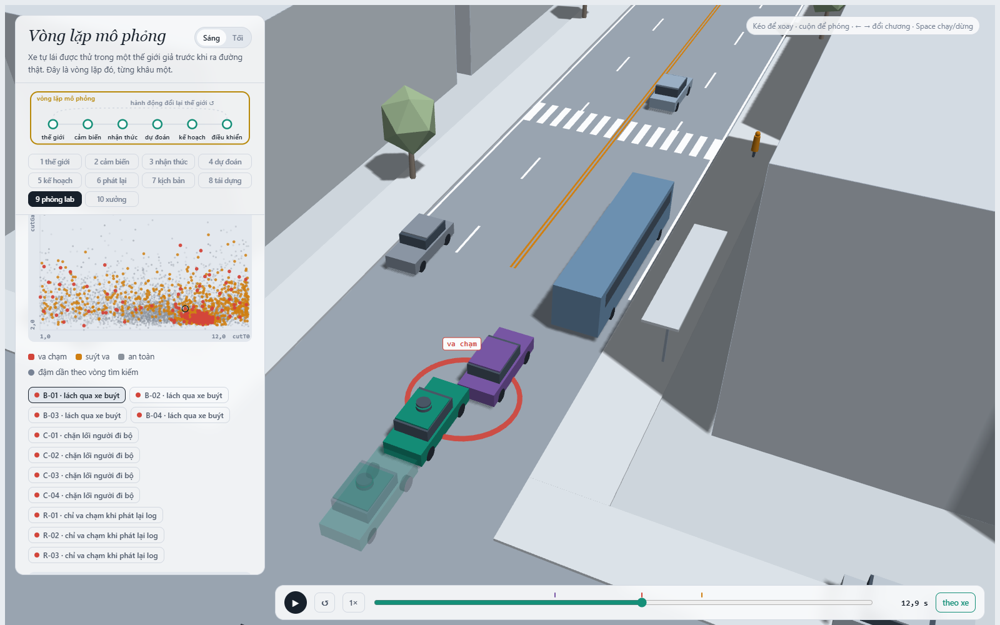
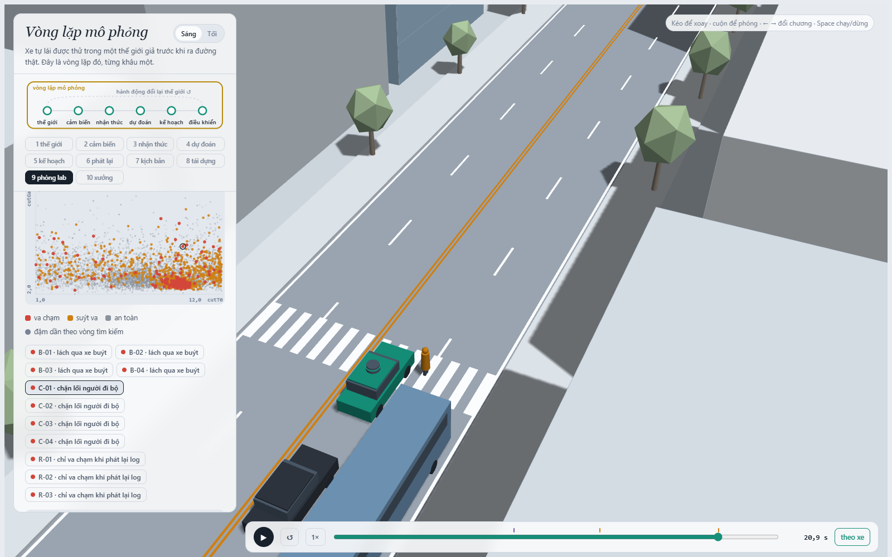
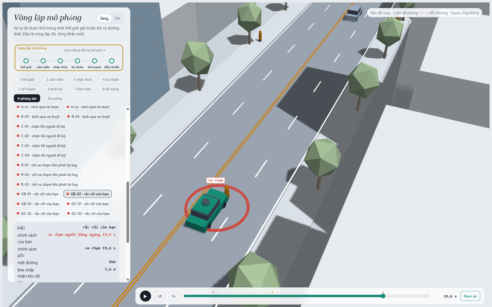

MSSV: 202602588

# Lab 11 · Scenario Forge — báo cáo

Mỗi câu: trả lời ngắn, **trích số từ `evidence/`** (ghi tên file và trường, ví dụ `mc.json: crashes = 4`). Grader chạy lại với MSSV của bạn; số không khớp `evidence/` thì mất điểm phần D (RUBRIC), và câu dựa trên số sai khó được điểm đầy đủ. Không cần văn hay: một bảng nhỏ và hai, ba câu giải thích là đủ.

Thị trấn của bạn (`meta.json: _run.town`): **B** (thị trấn mưa nhiều: P(đường ướt) = 0,30). Mọi số dưới đây lấy từ lần chạy đầy đủ `python run_all.py all` (`meta.json: _run.quick = false`).

## 1. Phát lại log có trung thực không? (bước A)

| `replay.json` | giá trị |
|---|---|
| `n` / `dropped_human_crash_logs` / `n_used` | 400 / 0 / 400 |
| `replay.crashes` (planner trên log phát lại) | **105**: `rear` 94, `side` 11 |
| `reactive.crashes` (planner trong thế giới phản ứng) | **1**: `front` 1 |
| `crash_in_both` | 1 |
| `len(replay_only)` (số kịch bản lưu làm ví dụ) | 20 |

Không log nào bị bỏ vì người lái va chạm (`dropped_human_crash_logs = 0`). Phần lớn va chạm khi phát lại là `rear` (94/105), vì xe phía sau (xe bám đuôi TG, xe làn bên) chạy **đúng quỹ đạo đã ghi** của người lái thật. Planner phanh sớm hơn hoặc chạy chậm hơn người lái (thận trọng gần xe buýt, `cautionV`) nên ở vị trí khác trong log; xe sau trong log không "biết" điều đó và đâm vào đuôi. Đó là va chạm **giả**: trong thế giới phản ứng, xe sau lái IDM, thấy xe ta giảm tốc thì giảm theo, và chỉ còn 1 va chạm (`reactive.crashes = 1`).

Ví dụ `replay_only[0]`: kịch bản 1, `contact = rear`, `params.tgT = 1,11 s` (xe bám đuôi giữ khoảng cách thời gian ngắn), đường khô (`mu = 0,8`). Trong log, người lái giữ tốc độ; planner giảm tốc khi tới gần xe buýt và vạch qua đường, còn xe bám đuôi phát lại vẫn chạy theo quỹ đạo cũ nên đâm vào đuôi xe ta. Cùng kịch bản trong thế giới phản ứng không va chạm, TTC nhỏ nhất vẫn còn 2,74 s (`min_ttc_reactive = 2.74`).

## 2. Kịch bản bất khả thi (bước B)

Các luật trong `is_feasible` (`lab11/feasible.py`):

| Luật | Căn cứ vật lý |
|---|---|
| a_lat = (π/cutDur)² · 3,5/2 > μg thì loại | Chuyển làn 3,5 m theo dạng cosin trong cutDur giây có gia tốc ngang đỉnh như vậy. Lốp không tạo được lực ngang vượt ma sát μg: xe sẽ trượt chứ không chuyển làn được. |
| cutBrake > μg thì loại | Gia tốc phanh dọc cũng bị giới hạn bởi ma sát. Trên đường ướt (μ = 0,5) chỉ phanh được tối đa 4,9 m/s². |
| pedV > 2,5 m/s thì loại | Đó là chạy, không còn là đi bộ qua đường. Tốc độ đi bộ thường quanh 1,2–1,5 m/s. |
| cutV ∉ (0, 22] m/s thì loại | Xe chuyển làn phải đang chạy, và không vượt xa tốc độ của phố đô thị (22 m/s ≈ 80 km/h). |

Số kịch bản bất khả thi bị bỏ trong `hunt.json`:

| Cuộc săn | `infeasible` |
|---|---|
| bus_bypass | 4 |
| cut_in | 8 |
| crosswalk_block | **12** |
| rear_ended | 10 |

Cuộc săn `crosswalk_block` sinh nhiều nhất. Đề xuất cuối của nó đẩy `p_bin[wet]` lên 0,97 (`hunt.json: crosswalk_block.proposal.p_bin[0]`), vì đường ướt làm quãng phanh dài ra và xe ta dễ dừng đè lên vạch. Nhưng trên đường ướt μg chỉ còn 4,9 m/s², nên những lần chuyển làn nhanh (cutDur ngắn) hoặc phanh mạnh sau khi vào làn vượt giới hạn ma sát, và kịch bản bị loại. Kịch bản bất khả thi thường "nguy hiểm nhất" (vì vật lý không cho phép), nên CEM bị kéo về phía đó. Nếu **đếm** chúng là va chạm, ước lượng sẽ bị thổi phồng bởi những sự kiện không thể xảy ra ngoài đời. CEM sẽ hội tụ vào vùng bất khả thi, và sửa planner cho những tình huống đó là phí công.

## 3. Monte Carlo cho bạn biết gì (bước C1)

`mc.json`: k = **2**, n = **3 000**, p̂ = **6,67e-4**, Wilson 95 % = **[1,83e-4; 2,43e-3]**. Cả hai vụ đều là `bus_bypass` (`modes = {bus_bypass: 2}`).

Để khoảng 95 % hẹp còn ±20 % của p cần 1,96·√(p(1−p)/n) ≤ 0,2p, tức n ≈ 96/p ≈ 96/6,67e-4 ≈ **144 000** lần chạy (khoảng 48 lần ngân sách MC hiện tại).

Các kiểu `cut_in`, `crosswalk_block`, `rear_ended` **chưa hề xuất hiện** trong 3 000 lần. Không báo 0 cho chúng. Con số đúng là một cận trên: Wilson với k = 0, n = 3 000 cho p < **1,28e-3** (đúng bằng `estimate.json: other.hi = 0.00128`), cỡ quy tắc ba 3/n = 1e-3.

## 4. Importance sampling, ESS và độ suy biến (bước C3)

`estimate.json: seeds[*].per` (mỗi kiểu n = 600 mẫu cho mỗi seed):

| Kiểu | Seed | `p` | `hits` | `ess` | `top_share` |
|---|---|---|---|---|---|
| bus_bypass | 0 | 5,20e-4 | 36 | 129 | 0,22 |
| bus_bypass | 1 | 2,66e-3 | 51 | 136 | **0,58** |
| bus_bypass | 2 | 1,53e-3 | 67 | 115 | **0,55** |
| crosswalk_block | 0 | 1,49e-6 | 66 | 138 | 0,41 |
| crosswalk_block | 1 | 3,8e-7 | 77 | 120 | 0,19 |
| crosswalk_block | 2 | 4,9e-7 | 59 | 119 | 0,22 |
| cut_in | 0/1/2 | 0 (cận `upper_zero_hits` = 0,025) | 0 | 121/104/118 | 0 |
| rear_ended | 0/1/2 | 0 (cận `upper_zero_hits` = 0,025) | 0 | 117/133/113 | 0 |

Tổng (`seeds[*].total`): 5,22e-4 / 2,66e-3 / 1,53e-3.

- **Ba seed không đồng ý nhiều:** `bus_bypass` chênh khoảng 5 lần (5,2e-4 đến 2,7e-3), `crosswalk_block` chênh khoảng 4 lần. Với MC (6,67e-4, Wilson [1,8e-4; 2,4e-3]) thì `bus_bypass` của cả ba seed đều nằm trong khoảng Wilson, nên phù hợp ở mức thô.
- **`top_share` > 0,5 ở seed 1 và seed 2 của `bus_bypass`:** một mẫu nặng nhất mang hơn nửa ước lượng. Khi đó p̂ = mean(w·y) thực chất là "trọng số của một mẫu chia cho 600": thêm hay bớt đúng mẫu đó là con số đổi gấp đôi. Khoảng ±1,96·se cũng không đáng tin (seed 1 có lo = 0). Ngược lại, `top_share` thấp không chứng minh ước lượng đúng, vì q có thể bỏ sót hẳn một vùng va chạm.
- **`crosswalk_block` theo IS cỡ 1e-6**, trong khi cuộc săn tìm ra tới 87 vụ. Cuộc săn kéo q về chỗ **dễ** gây va chạm (đường ướt, `pedLook` = 0), nhưng chỗ đó rất hiếm dưới p. Đây là bẫy 3: tìm ra một cách va chạm, không phải cách hay xảy ra nhất.
- **Ngân sách:** `budget = 16 800` lần chạy (gồm cả các vòng săn), so với khoảng 144 000 lần MC để có ±20 % (câu 3). Dù vậy, độ chênh giữa các seed cho thấy IS ở ngân sách này chưa đạt ±20 % thật.
- **Phần `other`:** lấy từ MC (`other = {k: 0, n: 3000, hi: 1,28e-3, source: mc.json}`). Va chạm không thuộc kiểu nào không có điểm nguy hiểm riêng để CEM tối ưu, nên không săn được. Mỗi kiểu chỉ được săn bằng điểm nguy hiểm của chính nó.

## 5. Các kiểu thất bại (bước C2 + 3D)

**bus_bypass**: `evidence/shots/q5_bus_bypass.png` (kịch bản B-01, 12,9 s, đường ướt μ = 0,5).

Xe buýt đỗ chắn làn ngoài. Xe cắt làn C2 (tím) chờ sau xe buýt, thấy một khe chấp nhận được (`cutGap` = 10,9 m) nên lách sang làn xe ta và chạy chậm dưới 6 m/s. Xe ta chưa coi C2 là xe phía trước cho tới khi nó lấn qua ngưỡng `cutinLat` = 2,15 m. Lúc đó đã quá gần, trên đường ướt thì phanh không kịp, xe ta đâm vào đuôi C2.

**crosswalk_block**: `evidence/shots/q5_crosswalk_block.png` (kịch bản C-01, 20,9 s, đường ướt).

Người đi bộ P1 không ngó qua xe buýt (`pedLook` = 0) và bước ra từ sau xe buýt. Cảm biến xe ta bị xe buýt che nên chỉ thấy P1 khi P1 đã ra lòng đường. Xe ta phanh gấp, nhưng trên đường ướt quãng phanh dài, nên dừng với thân xe trên vạch, và P1 phải đứng lại chờ.

**Không tìm thấy:** `cut_in` và `rear_ended`. Cuộc săn `cut_in` chỉ tìm ra `bus_bypass` (`hunt.json: cut_in.found = {bus_bypass: 26}`). Cuộc săn `rear_ended` tìm ra 1 `bus_bypass` và 1 `crosswalk_block`, không có vụ nào đúng kiểu, và `stopped_tightening = false` (elite level vẫn âm, −1,18). MC cũng không thấy (cận trên 1,28e-3). Mình tin ở mức vừa phải rằng hai kiểu này hiếm hơn cỡ 1e-3. Mình **không** tin rằng chúng bằng 0: cận đúng là `upper_zero_hits` = 0,025 cho mỗi seed, rất rộng.

**Nếu chỉ chạy một cuộc săn chung:** CEM co về kiểu dễ nhất. Ngay cả cuộc săn nhắm `cut_in` cũng trôi hết sang `bus_bypass` (26/26). Một cuộc săn chung sẽ chỉ báo `bus_bypass` (và có thể `crosswalk_block`), bỏ sót mọi kiểu khác. Vì thế mỗi kiểu cần một cuộc săn riêng với điểm nguy hiểm riêng.

## 6. Sửa planner (bước E + 3D)

Policy gốc (`fix.json: baseline_train.policy`): v0 = 12,5, T = 1,6, cautionV = 7,5, pedBuffer = 2,5, cutinLat = 2,15.
Policy được chọn: **`{cutinLat: 3.0}`** (`fix.json: chosen.policy`).

| | fail | fail_hi_seen | fail_hi | unseen | progress (m) | harsh (khung phanh > 3 m/s²) |
|---|---|---|---|---|---|---|
| Gốc, TRAIN | 4,74e-4 | 6,88e-4 | 6,88e-4 | – | 216,2 | 7,79 |
| Bản sửa, TRAIN | 2,46e-7 | 4,28e-7 | 4,28e-7 | bus_bypass | 215,8 | 7,61 |
| Bản sửa, **TEST** | **3,21e-6** | **8,54e-6** | **3,88e-2** | bus_bypass | 214,4 | 7,73 |
| Gốc, **TEST** | **1,92e-3** | 3,56e-3 | **4,84e-3** | – | 214,5 | 8,00 |

Trên TEST, cuộc săn mới nhắm vào bản sửa không tìm thấy vụ `bus_bypass` nào (`chosen_test.bus_bypass.hits = 0`), trong khi policy gốc có 30 vụ. Bản sửa giữ gần như nguyên quãng đường (214,4 so với 214,5 m) và phanh gấp ít hơn một chút (7,73 so với 8,00).

**Vì sao `fail_hi` của bản sửa (3,88e-2) lớn hơn cả `fail` của policy gốc (1,92e-3) dù bản sửa tốt hơn thật:** `bus_bypass` đã thành `unseen`, nên cận của nó là `upper_zero_hits` = 3/(0,2·400) = **0,0375**, cộng vào `fail_hi`. Với n = 400, không có 0 va chạm nào chứng nhận được xác suất dưới khoảng 15/n. `fail_hi` là cận trên hợp lệ, không phải ước lượng: nó nói "dữ liệu này chưa đủ để loại trừ 3,9 %", không nói "bản sửa nguy hiểm hơn". Muốn chứng nhận dưới 1e-3 cần khoảng 15 000 lần chạy trên đúng vùng đó.

**Ảnh có bóng mờ:** `evidence/shots/q6_fix_ghost_bus_bypass.png`.

Kịch bản B-01, do cuộc săn tìm ra dưới policy gốc. Xe đậm là policy gốc, đâm C2 lúc 12,9 s. Bóng mờ là bản sửa `cutinLat = 3.0`: nó coi C2 là xe phía trước ngay khi C2 mới lấn 3 m sang, nên phanh sớm và dừng phía sau, không va chạm.

**Núm "nghe thì an toàn hơn" nhưng làm tăng thất bại** (`fix.json: table`, TRAIN, so với policy gốc fail = 4,74e-4):

| Ứng viên | fail | bus_bypass hits | crosswalk_block hits |
|---|---|---|---|
| gốc | 4,74e-4 | 39 | 39 |
| `T: 2.0` (giữ khoảng cách thời gian xa hơn) | **2,80e-3** | 46 | 71 |
| `cautionV: 6.5` (chạy chậm hơn gần vạch bị che) | **2,25e-3** | 42 | 41 |

Cả hai nghe an toàn hơn nhưng fail tăng 5–6 lần. Thế giới phản ứng lại planner:
- **T lớn hơn** làm khe trước xe ta rộng hơn. Xe C2 lái theo gap acceptance (`cutGap`), thấy khe đủ rộng thì chen vào sau xe buýt, ngay trước xe ta, nên `bus_bypass` tăng.
- **T lớn hơn** cũng làm thời điểm xe ta tới vạch lệch đi. Người đi bộ chờ đến khi xe gần nhất **họ nhìn thấy** còn đủ xa. Xe ta ở xa hơn khiến họ quyết định bước ra, rồi xe ta tới khi họ đang ở giữa đường sau xe buýt, nên `crosswalk_block` tăng (71 so với 39).
- **`cautionV` thấp hơn** cũng mở khe cho C2 chen vào ngay trước xe ta. Chỉ khi chậm hẳn (`cautionV: 5.0`, fail 2,98e-4) mới đỡ, nhưng mất 20 % quãng đường (172,0 m), nên bị `choose_policy` loại.

## 7. Từ mô phỏng ra đường thật

| Giả định (`space.py`) | Dữ liệu thật để thay | Nếu sai thì con số sai theo hướng nào |
|---|---|---|
| **Khe xe chuyển làn chấp nhận** `cutGap` ~ lognormal(median 12 m, σ 0,5) | Quỹ đạo xe từ dataset drone/camera trên cao (highD, inD, NGSIM), hoặc log đội xe: đo khe trước/sau lúc xe bắt đầu chuyển làn, nhất là lúc lách qua xe buýt đỗ ở điểm dừng. | `bus_bypass` là kiểu trội và nhạy nhất với tham số này. Nếu tài xế thật (ví dụ xe máy, taxi ở Việt Nam) chấp nhận khe ngắn hơn thì p(bus_bypass) của mình đang bị **thấp**; ngược lại thì bị cao. |
| **Ma sát đường ướt** μ = 0,5 với P(ướt) = 0,30 (thị trấn B) | Số ngày mưa và tỉ lệ thời gian mặt đường ướt từ dữ liệu khí tượng địa phương. Hệ số bám đo bằng thiết bị đo ma sát mặt đường (skid trailer / GripTester) trên đúng loại mặt đường. | Đường ướt kéo dài quãng phanh, và cả `bus_bypass` lẫn `crosswalk_block` đều xảy ra chủ yếu khi ướt. Nếu μ thật khi ướt cao hơn (0,6–0,7) thì con số của mình bị **cao**; nếu mưa nhiều hơn 30 % thì bị **thấp**. |
| **Người đi bộ ngó qua xe buýt** `pedLook` = 0,85 và khe chấp nhận `pedGap` (median 4,5 s) | Quan sát video tại điểm dừng xe buýt có vạch qua đường: đếm tỉ lệ người dừng lại nhìn trước khi bước ra khỏi chỗ bị che, và khe thời gian họ chấp nhận. | `crosswalk_block` gần như chỉ xảy ra khi `pedLook` = 0 (đề xuất CEM có p_bin[pedLook] = 0,03). Nếu ít người ngó hơn 85 % thì p(crosswalk_block) của mình bị **thấp**, có thể nhiều bậc. |

## 8. Giới hạn

1. **Chỉ một con phố, một xe buýt, một vạch qua đường, thời lượng 24 s.** Xác suất báo ra là "mỗi lần đi qua đúng đoạn phố này", không phải mỗi km hay mỗi chuyến. Không có giao lộ, rẽ trái, đèn tín hiệu hay xe máy.
2. **Mọi người tham gia giao thông khác đều là IDM với gap acceptance "lịch sự"** (`civil = true`). Không có người lái say, mất tập trung, vượt đèn, hay xe máy luồn lách. Các phân phối p(u) là giả định dạy học, không khớp dữ liệu thật, nên con số tuyệt đối chỉ có nghĩa tương đối giữa các policy.
3. **Cảm biến hoàn hảo trừ phần bị xe buýt che:** không nhiễu, không trễ, không phát hiện sai hay bỏ sót. Planner có trạng thái thật, nên lỗi tri giác (ví dụ không nhận ra người đi bộ trong mưa) hoàn toàn không có trong con số. Ngoài ra, IS ở ngân sách này còn lệch giữa các seed 4–5 lần (câu 4), và hai kiểu `cut_in`, `rear_ended` chỉ có cận trên.

**Thêm một tuần:** mình sẽ đo độ nhạy của p(bus_bypass) theo `cutGap` median và μ khi ướt (hai giả định trội ở câu 7), tăng ngân sách IS cho tới khi ba seed đồng ý trong ±20 %, và thêm nhiễu/trễ tri giác để xem bản sửa `cutinLat = 3.0` còn giữ được không.

## 9. Rắc rối của bạn (bước G + chương 10)

- **Rắc rối:** người băng ngang giữa phố, chỗ không có vạch, từ lề phải (nam), đi vào đúng làn xe ta (`hazard.json: hazards[0] = {type: ped, side: S}`). Cảnh cụ thể: x = 176,8 m, v = 1,87 m/s, bước ra khi xe ta còn cách 38,5 m (`trig`). Ngoài đời, đây là người qua đường tắt giữa hai điểm dừng xe buýt, rất phổ biến ở phố Việt Nam.
- **Căn cứ:** planner chỉ có luật thận trọng (`cautionV`, `cautionRange`, `pedBuffer`) cho **vạch qua đường sau xe buýt**. Người bước ra ở chỗ khác không kích hoạt luật nào, và IDM chỉ phản ứng khi người đã ở trong làn, như một "xe phía trước" đứng yên. Bản sửa ở bước 6 (`cutinLat`) chỉ liên quan tới xe lấn làn, nên không nên cứu được.
- **Giả định** (`hazard.json: why`):
  - `space.h0_x` = [150, 300] m: đoạn phố xa vạch có sẵn.
  - `space.h0_v` = [1,0; 2,2] m/s: từ người già đi chậm tới người đi vội, quanh tốc độ đi bộ thiết kế 1,2–1,5 m/s.
  - `space.h0_trig` = [15, 45] m: khe khoảng 2–5 s ở 9–12 m/s.
  - `exposure` = 0,05 mỗi chuyến: **ước lượng thô của mình, chưa có số đo**. Cần đếm người băng ngang trên mỗi km từ camera giao thông hoặc log đội xe để thay.
- **Kết quả** (`mine.json`, `accepted = 0,992`: 1 488/1 500 phiên bản khả thi):

| | crashes | `avoidable` | `unavoidable` | `unattributed` | `low_speed` | `avoidable_foreknown` | P(lỗi planner \| rắc rối) [Wilson 95 %] | mỗi chuyến (`per_trip`) |
|---|---|---|---|---|---|---|---|---|
| Gốc (`baseline`) | 29 | **27** | 0 | 2 | 0 | 27 | 1,81e-2 [1,25e-2; 2,63e-2] | 9,07e-4 (cận 1,31e-3) |
| Bản sửa (`chosen`, cutinLat 3.0) | 26 | **26** | 0 | 0 | 0 | 26 | 1,75e-2 [1,20e-2; 2,55e-2] | 8,74e-4 (cận 1,27e-3) |

  - Mọi va chạm quy cho rắc rối đều **tránh được** bằng phanh hết cỡ ngay khi thấy. Không vụ nào không tránh được, và không vụ nào xảy ra khi xe ta gần đứng yên. Đây là lỗi planner thật, và bản sửa ở bước 6 **không cứu** (26 so với 27, khoảng Wilson trùng nhau gần hết).
  - `avoidable_foreknown` = `avoidable` cho thấy tầm nhìn bị che không phải nguyên nhân: cảm biến thấy người ngay khi họ bước ra (cảnh gốc: bước ra 20,3 s, đâm 23,7 s, hơn 3 s cảnh báo), nhưng planner không phản ứng đủ sớm.
  - 2 vụ `unattributed` của policy gốc (`by_hazard.unattributed = 2`) là va chạm thường của thị trấn: xe ta đâm thứ khác, hoặc người băng ngang chưa bước ra. Chúng không nói gì về rắc rối này. Bản sửa không có vụ nào, phù hợp với việc nó tránh được `bus_bypass`.
  - **So với lách xe buýt:** 9,07e-4 mỗi chuyến, cùng cỡ với p(bus_bypass) = 6,67e-4 theo MC (`mc.json`) và 5,2e-4–2,7e-3 theo IS (`estimate.json`). Nhưng con số này tỉ lệ thẳng với `exposure` 0,05 chưa có căn cứ đo.
- **"Tránh được" là chuẩn lạc quan theo hai hướng:**
  - Người phanh trong phép thử biết rắc rối ngay khung đầu tiên thấy nó, phanh tối đa, không có thời gian phản ứng. Nên `avoidable` **đếm nhiều hơn** số vụ một planner thật (có trễ tri giác và quyết định) tránh được. Đây là cận trên của "lỗi planner".
  - Phép thử chỉ thử phanh, không thử đánh lái. Những vụ né được bằng đánh lái sang làn trống vẫn bị tính `unavoidable`, nên theo hướng này nó **đếm ít đi**.
- **Hình:** `evidence/shots/q9_jaywalker.png` (chương 9, kịch bản GB-02, va chạm lúc 19,6 s).
  
- **Bạn tự lái thì sao:** mình lái thử trên đúng cảnh gốc, ghi thành chuỗi bàn đạp `hazard.json: egoAcc` (`ego = "script"`, cùng định dạng chương 10 lưu khi bấm "Bạn"). Cách lái: giữ ga như planner tới lúc thấy người bước ra khỏi lề (20,3 s; cảm biến thấy ngay, không bị che), cộng thời gian phản ứng 1,5 s của người, rồi phanh đều 4 m/s², nhẹ hơn mức tối đa μg = 4,9 m/s² của đường ướt. Kết quả `mine.json: exact.you = []`: **không va chạm**, còn `exact.planner = [ego–H0 lúc 23,7 s]`. Khác biệt nằm ở **lúc bắt đầu phanh**, không phải ở mức phanh:
  - Planner thấy người từ 20,3 s nhưng vẫn **tăng tốc** (a ≈ +0,3 đến +0,7 m/s², từ 9,8 lên 11,3 m/s), vì người còn ở làn bên kia và chưa thành "xe phía trước".
  - Planner chỉ phanh hết cỡ (−4,9 m/s²) lúc 23,3 s, khi người đã bước vào làn xe ta, cách khoảng 6 m. Lúc đó đã quá muộn.
  - Người lái thì đoán được "người này sẽ băng qua tới làn mình" và nhả ga, phanh sớm. Thử thêm trên cùng cảnh với phanh 6 m/s²: phản ứng trong vòng 2,4 s vẫn tránh được; từ 2,6 s trở đi thì va chạm.
  - Cũng phải nói: mình đã biết trước cảnh này sẽ xảy ra, planner thì không. Nhưng 2,4 s vẫn dư so với thời gian phản ứng thông thường của người lái (khoảng 1–1,5 s).
- **Cách sửa:** `cutinLat` không liên quan. `pedBuffer` và `cautionV` chỉ tác dụng gần vạch qua đường bị che, không giúp ở giữa phố. Planner cần **logic mới**: theo dõi mọi người đi bộ cảm biến thấy ở lề hoặc lòng đường (không chỉ ở vạch), dự đoán quỹ đạo cắt ngang làn của họ. Nếu thời gian tới điểm cắt của người và của xe ta chồng nhau trong biên an toàn, thì giảm tốc hoặc dừng ngay, thay vì chờ tới khi người đã đứng trong làn mới coi là chướng ngại.
